This post goes through the Convert audio screen in Convertit Pro, one setting at a time. It covers what each option does, what the defaults are and when you might want to change them.

Everything runs on your phone. Your files are never uploaded anywhere.

## Opening the converter

Open the app, tap **Open tools**, then **Convert audio**. Android's file picker opens, and you can pick one file or many.

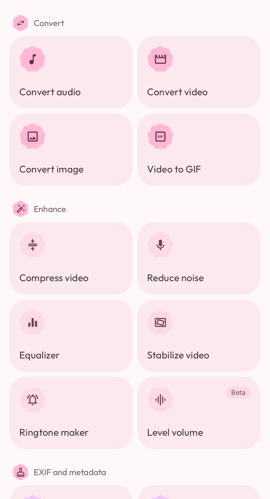

After you pick your files, you get the full settings page. The basic options are at the top and the extras are in switch cards below them. The buttons at the bottom are always there.

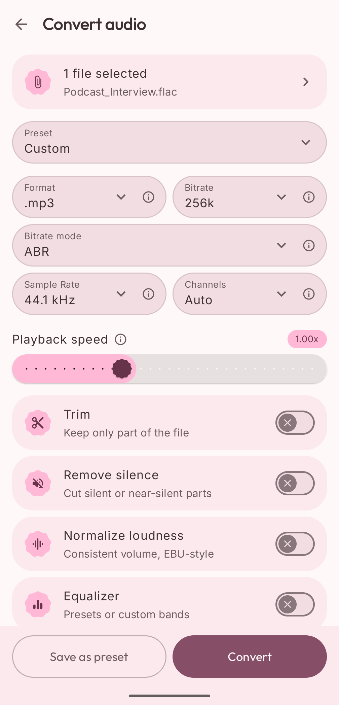

## Files

The first row shows how many files you picked. With one file it shows the file name. Tap it to see the full list, where you can remove a file or add more. If you remove the last file, the converter closes.

Some options only work with a single file: **Trim** and **Track splitting**. With more than one file, the app hides them.

## Presets

A preset fills in all the settings at once. **Custom** means you're picking them yourself. The built-in presets are:

- **Max Compression FLAC**: lossless FLAC at the highest compression level (12), stereo, 44.1 kHz.
- **High Quality MP3**: 320k, stereo, 44.1 kHz.
- **Space Saving MP3**: 128k, stereo, 44.1 kHz.
- **Podcast AAC**: M4A at 128k, mono, 44.1 kHz. Good for speech.
- **High Quality Opus**: 192k, stereo, 48 kHz.

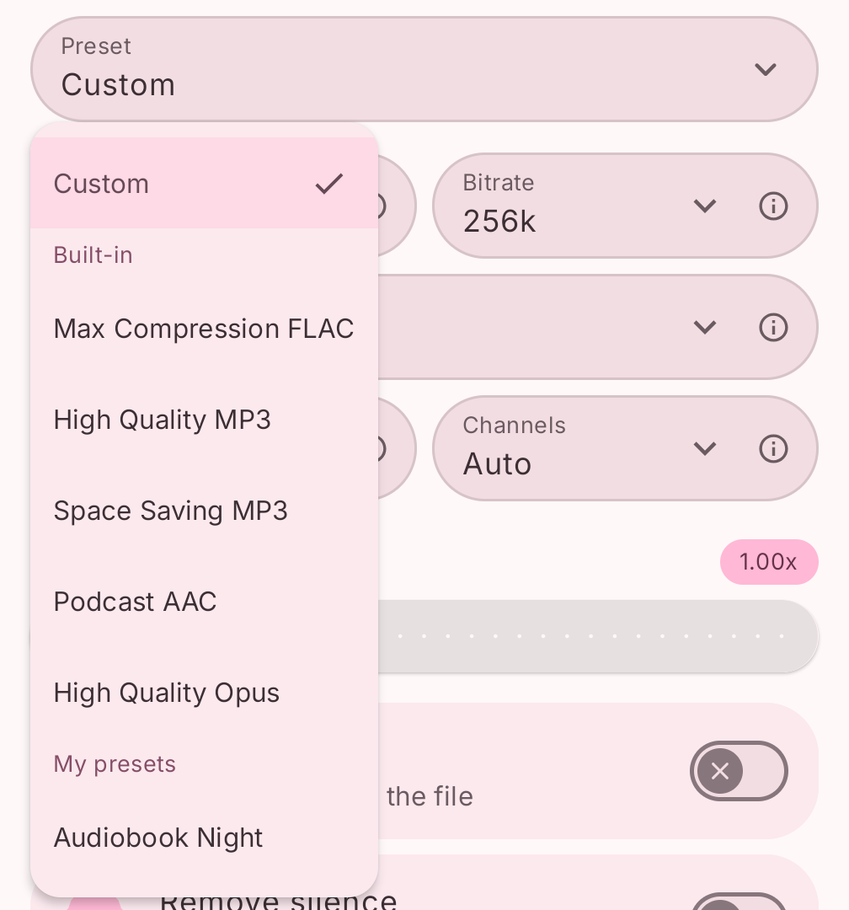

Presets you save yourself show under **My presets**. If you change the format, bitrate or one of the switch cards after picking a preset, it switches back to Custom.

Note: the menu only shows presets that work for your files. For example, a FLAC preset won't show when you've picked MP3 files (see the next section for why).

## Format

This is the type of file you get. You can choose from 13 audio formats:

- **Lossy** (smaller files, some detail is thrown away): MP3, M4A, AAC, OGG, Opus, WMA, MKA, SPX and AMR.
- **Lossless** (every bit of the original is kept): FLAC and ALAC.
- **Uncompressed** (biggest files): WAV and AIFF.

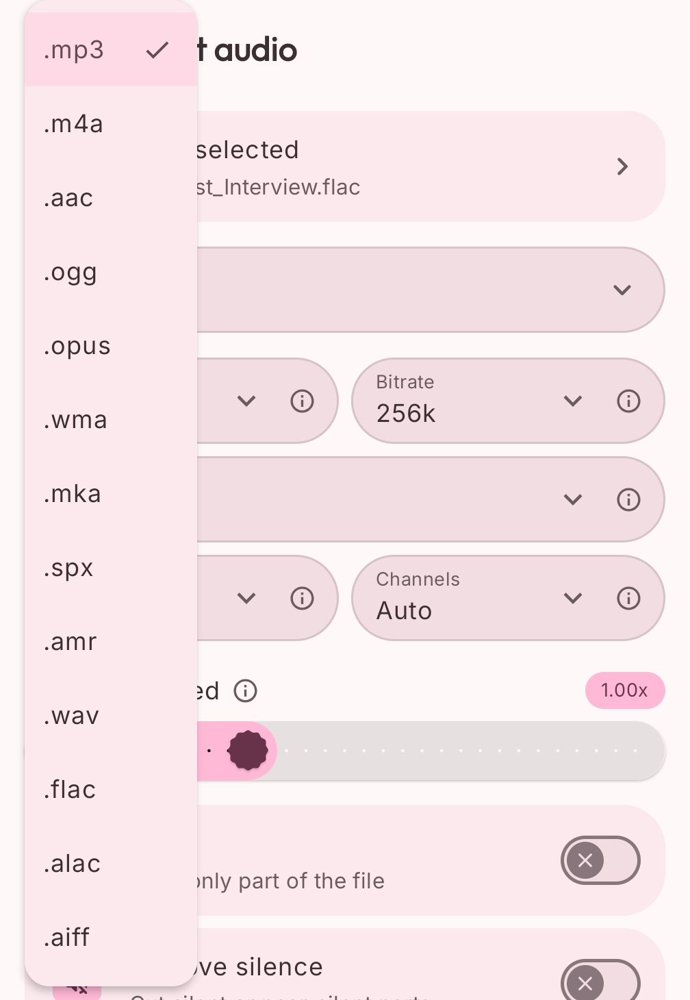

If you're not sure, MP3 plays on everything. Opus gives the best quality for its size. M4A works well on Apple devices.

A few things to know:

- If any of your files are lossy (an MP3, for example), the lossless and uncompressed formats are hidden. Converting an MP3 to FLAC makes a much bigger file without bringing any quality back, so the app doesn't offer it.
- M4A and MKA files can hold either lossy or lossless audio, and the file name can't tell which. So they don't hide the lossless formats.
- ALAC is saved as an `.m4a` file, because that's the container ALAC lives in.
- AMR is made for voice recordings. It's always mono and has no bitrate mode.

## Bitrate

Bitrate is how much data is used for each second of audio. Higher sounds clearer and makes bigger files. 128k is fine for speech, and 256k or 320k keeps more detail.

The list changes with the format, sample rate and channels. For example, MP3 goes from 64k to 320k, while Opus goes from 16k to 320k. The app only shows bitrates the encoder can actually produce for your settings. If you change something that makes your current bitrate impossible, it moves to the nearest lower one.

Bitrate doesn't apply to FLAC, ALAC, WAV and AIFF. They keep all the audio, so their size comes from the audio itself.

## Bitrate mode

This controls how the encoder uses the bitrate:

- **CBR** (constant): the same bitrate the whole way through. The size is predictable, and some older players need it.
- **VBR** (variable): uses more data on busy parts and less on quiet ones. Usually the best quality for the size.
- **ABR** (average): changes like VBR but stays close to your target overall. This is the default.

WMA and SPX only offer CBR and ABR. The setting is hidden for AMR and for the lossless and uncompressed formats.

## FLAC compression level

When you pick FLAC, a slider from 0 to 12 shows up in place of the bitrate mode. The default is 5.

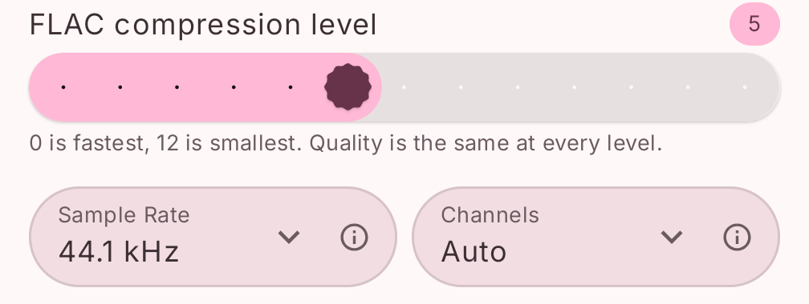

The sound is exactly the same at every level. A higher level just takes longer to encode and gives a slightly smaller file. If you're archiving audio, 12 is worth it. If you're in a hurry, 0 is fastest.

## Sample rate

This is how many samples of sound are stored each second. 44.1 kHz is CD quality and 48 kHz is common for video. Lower rates cut the high frequencies, which is fine for voice but noticeable on other audio.

The list depends on the format. Opus works from 8 to 48 kHz, and AMR only supports 8 and 16 kHz, the rates used for phone calls. If you switch to a format that doesn't support your current rate, the app picks one that works.

## Channels

- **Auto** keeps the channels of the original file when it can.
- **Mono** is one channel. It's usually fine for speech, and the same bitrate goes further when it only has one channel to cover.
- **Stereo** is left and right.

Note: AAC, M4A, OGG, MKA and WMA can't hold surround sound here. A 5.1 file is mixed down to stereo for those formats.

## Playback speed

Makes the output faster or slower, from 0.50x to 2.00x. The pitch stays the same, so voices don't sound like chipmunks. The length of the file and its size change with the speed.

This is useful for lectures or podcasts you always listen to at 1.5x. Convert them once and they play at that speed anywhere.

## Trim

Keeps only part of the file. Turn on the **Trim** switch and the card opens with a preview player and a range slider.

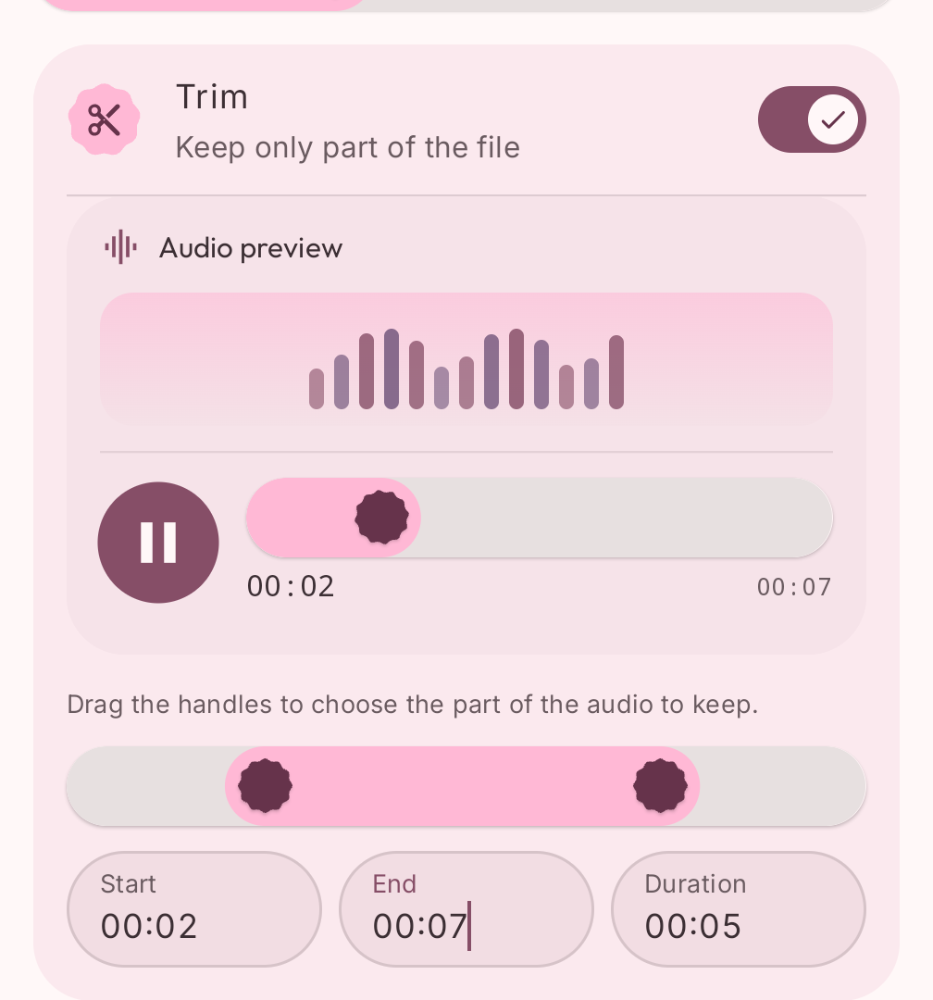

Drag the two handles to choose the part you want to keep, or type the times into **Start** and **End**. You can type `MM:SS` or `MM:SS.mmm` if you need millisecond precision. **Duration** updates by itself. Press play to hear the part you've chosen before converting.

Note: Trim only works with a single file, and it's turned off while Track splitting is on.

## Remove silence

Cuts out silent or near-silent parts. This is handy for voice notes, lectures or interviews with long pauses.

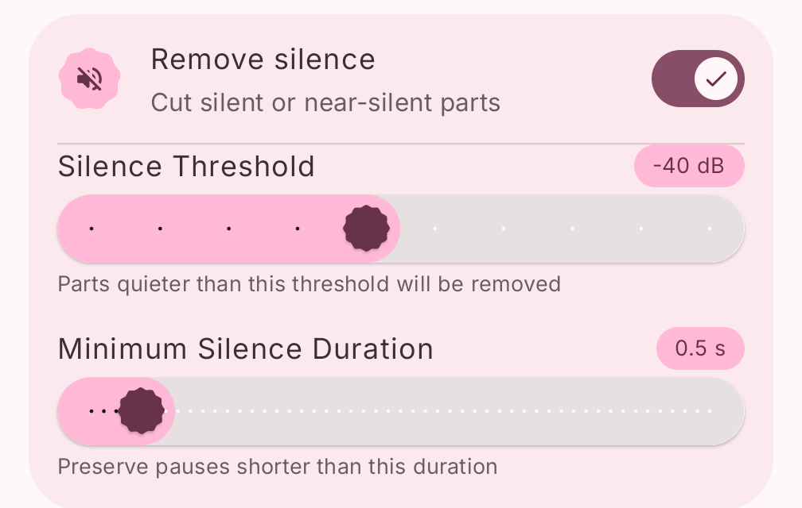

There are two sliders:

- **Silence threshold** (−60 to −20 dB, default −40 dB): anything quieter than this counts as silence. Move it toward −20 if background noise isn't being cut. Move it toward −60 if quiet speech is being cut.
- **Minimum silence duration** (0.1 to 5 seconds, default 0.5): pauses shorter than this are kept. This keeps the natural gaps between words and sentences.

Remove silence only works when the output is an audio format.

## Normalize loudness

Makes files play at the same volume, so you don't have to touch the volume button between tracks. It's based on EBU R128, the loudness standard broadcasters and streaming services use.

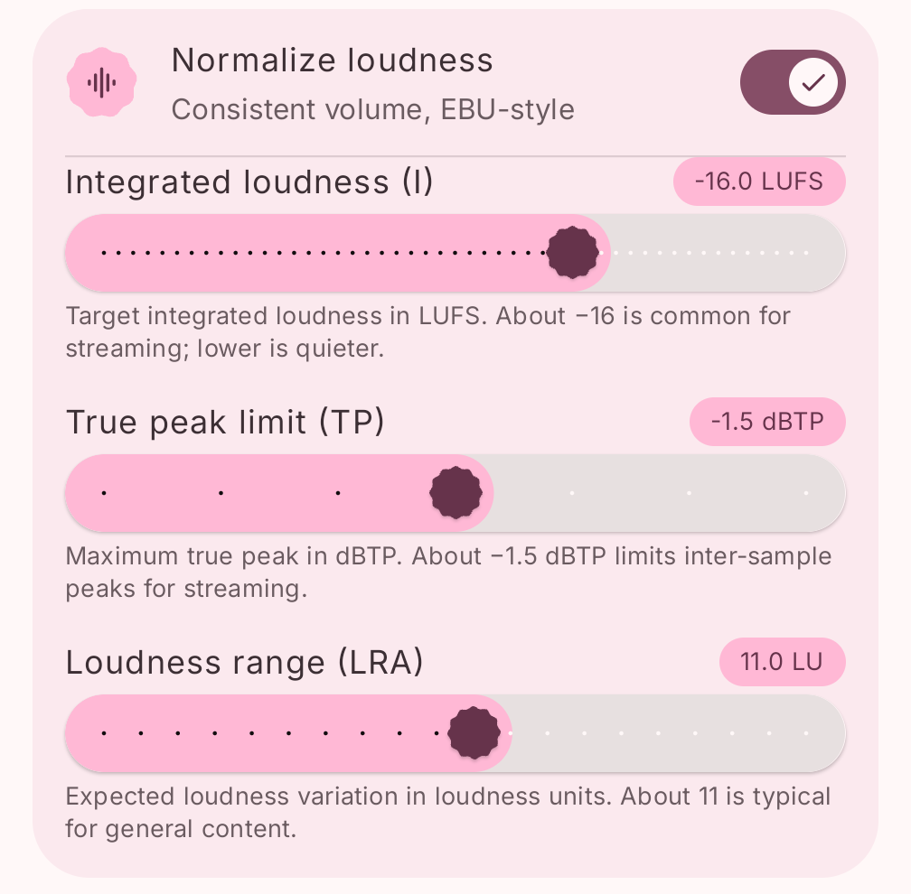

The defaults are a common streaming and podcast target, so most of the time you can just turn it on:

- **Integrated loudness** (−32 to −8 LUFS, default −16): how loud the whole file is on average. Lower is quieter.
- **True peak limit** (−3 to 0 dBTP, default −1.5): the loudest any moment is allowed to get. Keeping it under 0 stops clipping when the file is played or converted again later.
- **Loudness range** (1 to 20 LU, default 11): how much the volume is allowed to move between quiet and loud parts. Lower values make it more even.

## Equalizer

Boosts or cuts parts of the sound. There are five bands: 60 Hz (deep bass), 250 Hz (warmth), 1 kHz (voice), 4 kHz (clarity) and 14 kHz (air). Each one goes from −12 to +12 dB.

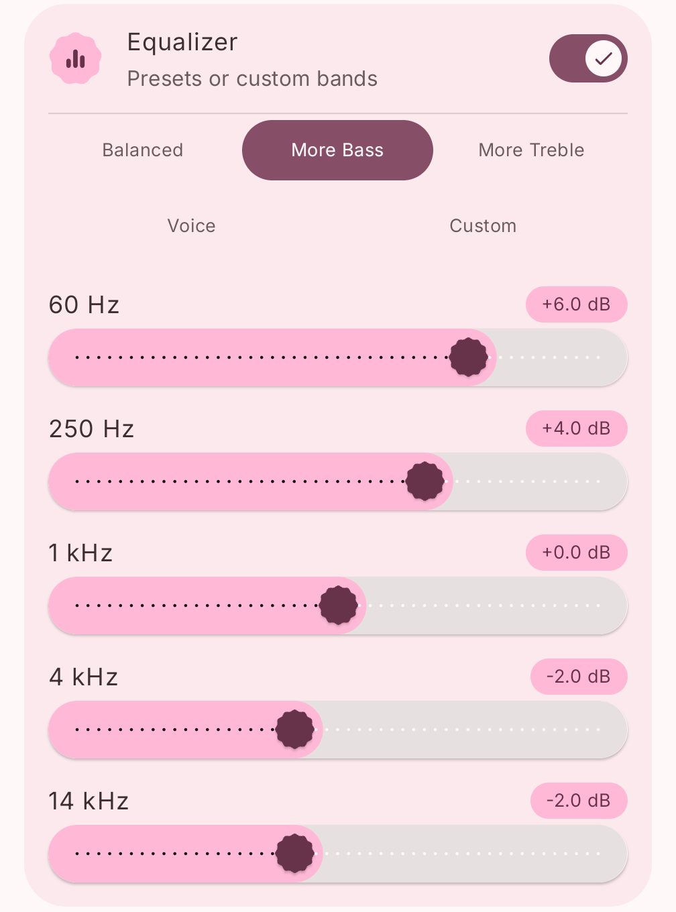

You can start from a preset:

- **Balanced**: everything flat.
- **More Bass**: +6 and +4 dB on the low end, a little less on top.
- **More Treble**: the opposite of More Bass.
- **Voice**: lifts 1 and 4 kHz and lowers the bass, so speech is easier to follow.

Moving any slider switches the preset to **Custom**. The equalizer only shows when the output is audio.

## Track splitting

Some recordings come as one big file (often FLAC or WAV) with a `.cue` sheet next to it that lists where each track starts. Turn on **Track splitting**, tap **Select CUE file** and pick that sheet. You get one file per track instead of one long file.

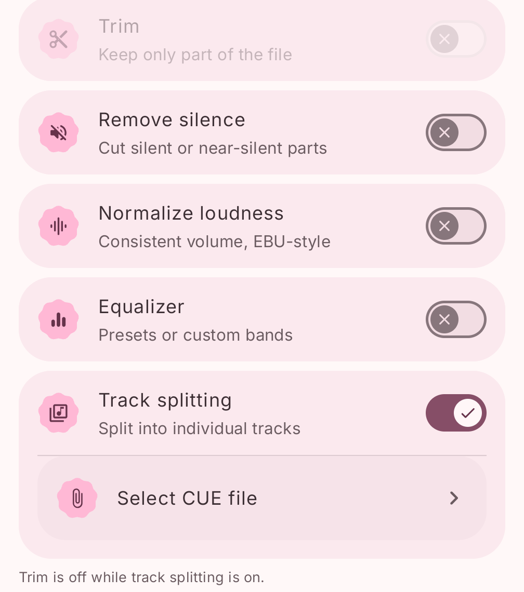

Note: this only works with a single file. Trim is turned off while it's on, since the CUE sheet already decides where to cut.

## Output folder and estimate

At the bottom of the page you'll see where the files will be saved and a rough estimate of the size and encode time.

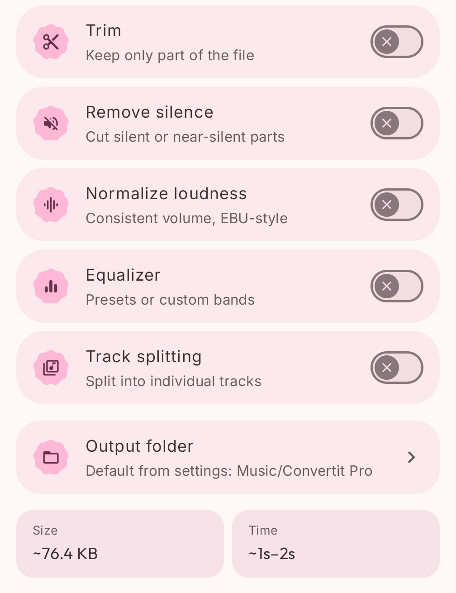

By default, files go to the folder set in Settings (Music/Convertit Pro). Tap **Output folder** to save this conversion somewhere else. A reset button appears next to it so you can go back to the default.

The estimate updates as you change settings. It's a rough guess, because the real result depends on your file and your phone. There's no estimate when Remove silence or Track splitting is on, because the app can't know in advance how much will be cut.

## Converting and saving presets

- **Convert** starts the conversion. It runs in the background with a notification, so you can leave the app while it works.
- **Save as preset** saves everything on the screen under a name of your choice, including Remove silence, Normalize loudness and Equalizer. It shows up under My presets next time.

If you picked several files, they're all converted with the same settings.

## A few recipes

- **Shrink a lecture recording**: Podcast AAC, then turn on Remove silence. Set the playback speed to 1.25x if you like it faster.
- **Make a FLAC collection smaller without losing anything**: FLAC with the compression level at 12.
- **Make audio fit on a small phone**: Opus at 128k. Opus holds up well at lower bitrates.
- **Get podcast episodes to the same volume**: turn on Normalize loudness and leave the defaults.
- **Split one long recording into tracks**: pick the big file, turn on Track splitting and select its `.cue` file.

If something doesn't work the way this post says, or you think a setting is missing, [let us know](/contact/).

Tamim 
Director, The Byte Array
