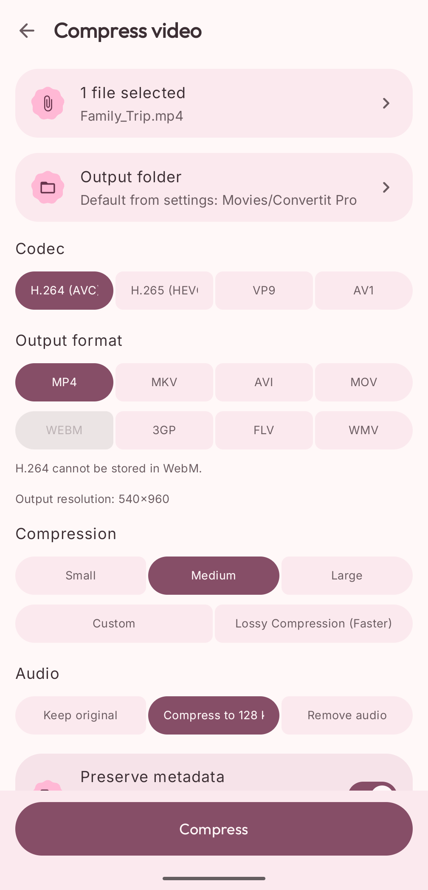
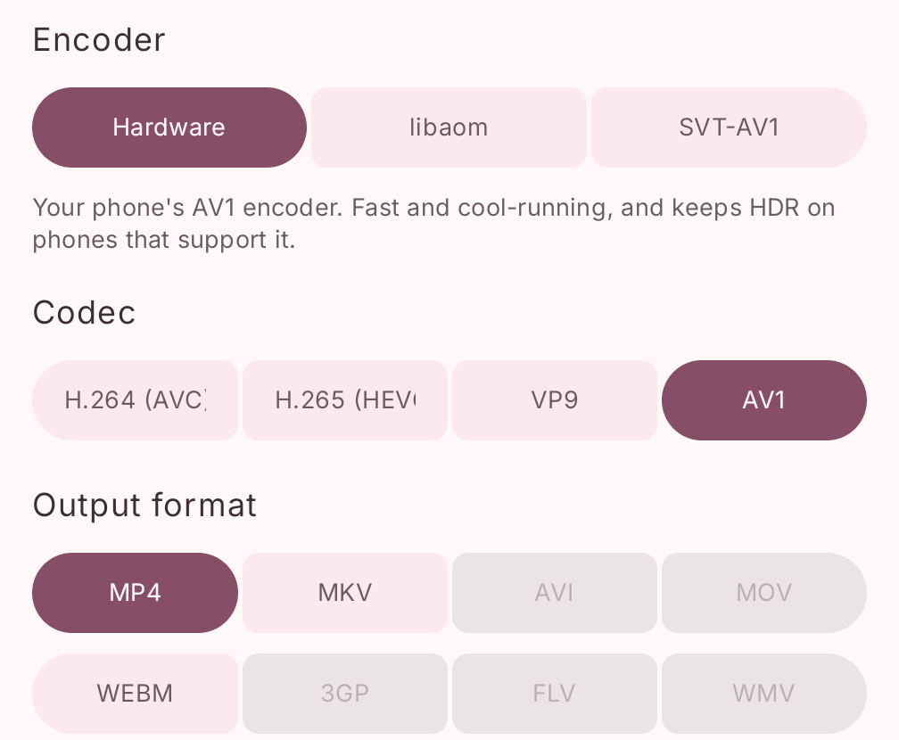
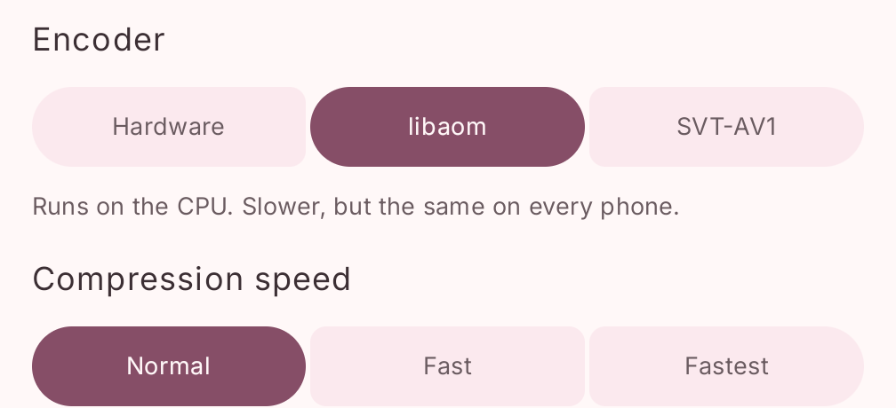
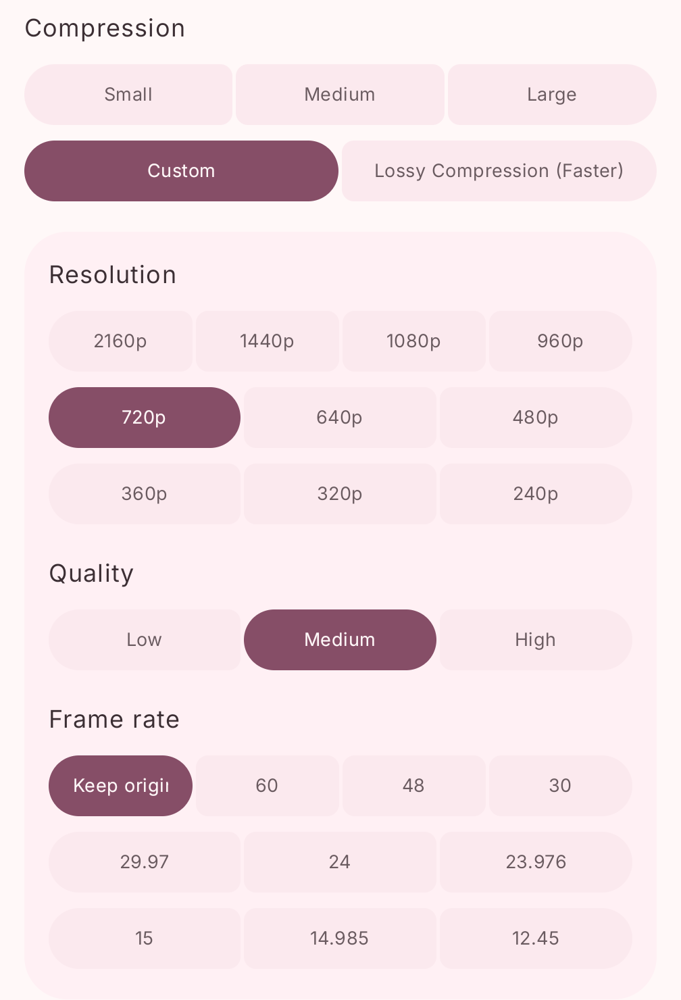
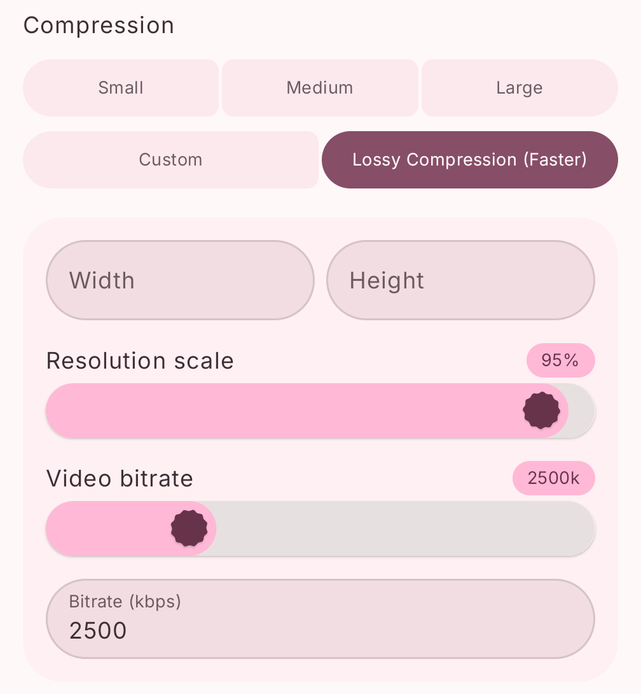

This post goes through the Compress video screen in Convertit Pro, one setting at a time. It covers what each option does, what the defaults are and which ones are worth changing.

Everything runs on your phone. Your videos are never uploaded anywhere.

## Opening the compressor

Open the app, tap **Open tools**, then **Compress video**. Pick one video or several from Android's file picker.

The app reads each file first (size, resolution, HDR and so on), so the screen may show "Reading file info…" for a moment. The **Compress** button turns on once that's done.

If you only want a smaller file, you don't need to change anything: the defaults (H.264, MP4, Medium) work on every phone and play everywhere. The rest of this post is for when you want more control.

## Files and output folder

The first row shows how many videos you picked. Tap it to see the list, remove a video or add more. All the videos are compressed with the same settings.

**Output folder** shows where the files will be saved. By default that's the folder from Settings (Movies/Convertit Pro). Tap it to pick a different folder for this run. A reset button appears next to it so you can go back to the default.

## Codec

The codec is how the picture is compressed. Newer codecs make smaller files at the same quality, but they take longer to encode.

- **H.264 (AVC)**: the default. Plays on everything and encodes quickly.
- **H.265 (HEVC)**: about the same quality in a noticeably smaller file. Plays on most phones, TVs and computers made in the last few years.
- **VP9**: an open codec from Google, used a lot on the web. Smaller files than H.264.
- **AV1**: the newest one. The smallest files for the quality, but also the slowest to encode, and older devices may not play it.

H.264 and H.265 always use your phone's built-in video encoder, so they're fast and don't heat the phone much. VP9 always runs on the CPU, which is a lot slower. AV1 lets you choose (see [Encoder](#encoder-av1-only) below).

Note: H.265 only shows if your phone has an H.265 encoder. Most phones from Android 10 onwards do.

## Output format

This is the container the video is saved in: MP4, MKV, AVI, MOV, WebM, 3GP, FLV or WMV. If you're not sure, pick MP4.

Not every container can hold every codec, so the app greys out the ones that won't work and tells you why:

- **MP4** and **MKV** hold all four codecs.
- **MOV** holds H.264 and H.265.
- **WebM** holds only VP9 and AV1.
- **AVI**, **FLV**, **WMV** and **3GP** hold only H.264.

This works both ways. If you pick WebM first, H.264 and H.265 are greyed out in the codec row.

Tip: with H.264 or H.265, MP4 is the best choice. The video goes through the phone's own video pipeline from start to finish, and HDR can be kept. Other containers take a different route that always writes 8-bit video, so HDR is lost.

## Encoder (AV1 only)

When you pick AV1, an **Encoder** row appears with up to three choices:

- **Hardware**: your phone's own AV1 encoder. Fast, doesn't heat the phone much, and keeps HDR on phones that support it. It only shows if your phone has one, and it's only used for MP4. For MKV or WebM, the CPU encoder is used instead.
- **libaom**: runs on the CPU. Slower, but it gives the same result on every phone.
- **SVT-AV1**: also runs on the CPU, but built for speed. HDR videos still use libaom.

## Compression speed

This row only shows when the video is encoded on the CPU, so for VP9 and for AV1 with libaom or SVT-AV1.

- **Normal**: the smallest file, and the slowest.
- **Fast** and **Fastest**: finish sooner, but the encoder doesn't work as hard, so the file comes out a bit bigger or a bit softer.

Note: CPU encoding is slow. If any of your videos are bigger than 1080p, the app warns you that it can take a very long time and suggests H.265 in MP4 instead. Android also stops background jobs after 6 hours. If that happens, the app tells you so you can try a faster setting or a shorter video.

## Compression

This is the main choice: how much smaller the video should get. Under the format row, **Output resolution** shows the size you'll get, so you can check before you start.

- **Small**: the width and height are divided by 3 and quality is set lower. The smallest file. A 1080×1920 video comes out at 360×640.
- **Medium**: the width and height are divided by 2. A good balance, and the default.
- **Large**: keeps the full resolution and only compresses the picture. The closest to the original.
- **Custom**: you choose the resolution, quality and frame rate yourself.
- **Lossy Compression (Faster)**: you choose the exact size and bitrate.

With Small, Medium and Large, the bitrate is worked out from the output size, so the quality stays about the same no matter how big the source was.

### Custom

Pick **Custom** and a panel opens with three rows.

- **Resolution** (2160p down to 240p, default 720p): the largest size the video can be. The video is shrunk to fit inside a landscape box of that size (1280×720 for 720p) and keeps its shape. If it already fits, it isn't made bigger.
- **Quality** (Low, Medium or High, default Medium): higher quality makes a bigger file.
- **Frame rate** (Keep original, or 60 down to 12.45 fps): fewer frames per second makes a smaller file. Picking a rate higher than the source does nothing. The app never adds frames.

Note: because the box is landscape, a portrait video comes out narrower than you might expect. A 1080×1920 phone video at 720p becomes 406×720. Check **Output resolution** before you start, or use 1080p or Lossy Compression for portrait videos.

### Lossy Compression (Faster)

Pick this when you want to set the numbers yourself.

- **Width** and **Height**: the largest size you want. The video is scaled to fit inside it and keeps its shape. Leave them empty to use the scale slider instead.
- **Resolution scale** (5% to 100%, default 95%): shrinks the video by a percentage when Width and Height are empty.
- **Video bitrate** (default 2500 kbps): how much data each second of video gets. The slider goes from 200 to 10,000 kbps. For more, type it into **Bitrate (kbps)**, up to 50,000.

This mode uses a constant bitrate, so the file size is easy to predict: about the bitrate × the length of the video, plus the audio.

## Audio

- **Keep original**: copies the sound as it is, with no quality loss. If the format you picked can't hold the original sound (for example, AAC sound in a WebM file), it's compressed to 128 kbps instead (Opus for WebM, AAC for the rest).
- **Compress to 128 kbps AAC**: the default. Good enough for nearly everything and saves a bit of space.
- **Remove audio**: no sound at all. Useful for clips you'll add your own sound to later.

## Preserve metadata

On by default. Keeps the title and other tags from the original file. Turn it off if you don't want those details in the compressed copy.

## HDR

These switches only show when one of your videos is HDR (for example, recorded with HDR on a recent phone).

- **Preserve HDR** keeps HDR10 or HLG colour and 10-bit depth. It works with H.265 in MP4 on phones that support HDR encoding, with VP9, and with AV1. It's on by default. H.264 can't do 10-bit HDR, so with an HDR video the codec moves from H.264 to one that can, and H.264 is greyed out while this is on.
- With **Preserve HDR** off, the video is converted to normal (SDR) colour. The app uses the phone's tone mapping when it has it. Without it, the picture can look a bit washed out.
- **Preserve HDR10+** keeps the extra per-frame brightness data that HDR10+ videos have. With VP9 it saves as WebM.

Note: Dolby Vision is never kept as Dolby Vision. A Dolby Vision video is saved as H.265 with normal HDR (HLG or PQ). It looks the same on phones.

## Compressing

Tap **Compress**. The work runs in the background with a progress notification, so you can leave the app. With several videos, you can cancel one from the home screen and the others keep going.

A few things the app checks for you:

- **Storage**: if there isn't enough free space for the output, it tells you how much it needs.
- **Bigger output**: some videos are already well compressed. If the result is bigger than the original, the file is still saved and the app tells you, so you can keep whichever one you want.
- **Phone limits**: if your phone's encoder can't handle the settings you picked, the app falls back to settings it can handle (usually H.264 at a lower size) and tells you what it changed.

## A few recipes

- **Share on a messaging app**: Medium, H.264, MP4. Plays on every phone.
- **Save storage but keep it sharp**: Large with H.265 in MP4. Same resolution, much smaller file.
- **Smallest file possible**: Small with AV1 (Hardware if your phone has it). Make sure the place you'll play it supports AV1.
- **Keep a phone's HDR video looking right**: H.265, MP4, Preserve HDR on.
- **Screen recording or slideshow**: Custom with a lower frame rate (15 or 24) and Medium quality.

If something doesn't work the way this post says, or you think a setting is missing, [let us know](/contact/).

Tamim 
Director, The Byte Array
